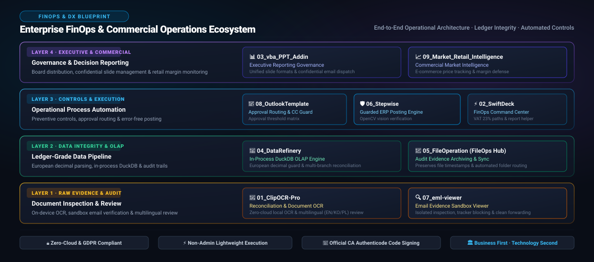

*다른 언어로 읽기: [English](README.md), [한국어](README.ko.md), [Polski](README.pl.md)*

# 박광범 (Kwang Beom Park)

**Senior Finance Manager (Finance Head) | 엔터프라이즈 FinOps & 오퍼레이션 DX 아키텍트**  
*폴란드 바르샤바 소재 (Warsaw, Poland)*

> **재무 거버넌스와 현장 엔지니어링의 결합**  
> *유럽 현지 법인의 장부 무결성, 세무 컴플라이언스, 결산 자동화를 현장에서 직접 실현하는 Senior Finance Manager (Finance Head)*  
> `> "원천 전표 증빙에서 최고 경영진 보고까지, 오퍼레이션의 확실성을 직접 구축합니다."`

<p align="center">
  
</p>

[LinkedIn 프로필](https://www.linkedin.com/in/kwangbeompark) · [GitHub 전체 저장소](https://github.com/KwangBeomPark?tab=repositories) · [이메일 문의](mailto:park.kwangbeomi@gmail.com)

---

## 🏛️ 경영진 요약 및 리더십 철학 (Executive Summary)

저는 유럽 다국적 기업 현지 법인에서 **재무 회계, 커머셜 비즈니스 컨트롤, 채권 신용 관리(Credit Control), 현지 세무 컴플라이언스(VAT 23% / JPK_V7 / IFRS)**를 총괄해 온 시니어 재무 리더입니다.

재무 리더십과 더불어 저는 **"비즈니스 문제가 우선이고, 기술은 수단이다(Business problem first, technology second)"**라는 명확한 실천적 엔지니어링 철학을 가지고 있습니다. 현업의 특수성을 반영하지 못하는 수억 원대의 무거운 외부 패키지 소프트웨어나 외주 IT 개발에 의존하기보다, 재무 조직 내부에서 직접 보안과 감사 요건을 충족하는 경량 자동화 파이프라인을 설계하고 정착시킵니다.

### 핵심 리더십 원칙:
- **원천 장부 수준의 데이터 정합성 (Ledger Integrity)**: 총계정원장에 전기되기 전 단계에서부터 거래 이상치와 계산 왜곡을 원천 차단합니다.
- **실천적인 내부 통제 (Pragmatic Internal Controls)**: 복잡한 관료주의적 결재 지연 없이, 전결 규정과 시각적 검증을 자동화하여 실무 휴먼에러를 사전에 방지합니다.
- **TCO 최적화 및 오퍼레이션 민첩성**: 기업 보안 규정과 유럽 GDPR을 100% 준수하면서도, 외부 클라우드 데이터 반출 없이 로컬에서 안전하게 실행되는 무설치(Non-Admin) 파이프라인을 배포합니다.

---

## 💼 핵심 기능별 포트폴리오 매트릭스 (PL Suite)

**PL Suite (01–08)** 및 확장 인텔리전스 플랫폼은 전체 재무 사이클에 걸쳐 데이터 무결성을 수호하고 오퍼레이션 병목을 해소하기 위해 상호 유기적으로 결합된 통합 실무 생태계입니다.

| 경영 관리 책무 | 솔루션 | 핵심 역할 및 오퍼레이션 개선 효과 | 주요 기술 아키텍처 |
| :--- | :--- | :--- | :--- |
| **I. 결산 가속화 및 장부 정합성** | [**04_DataRefinery**](https://github.com/KwangBeomPark/04_DataRefinery) | **인프로세스 DuckDB OLAP & 유럽식 소수점 가드**<br>유럽식 쉼표 소수점(`12,34` vs `12.34`) 오인식으로 인한 수치 왜곡을 원천 방지하고, 복잡한 프로모션 데이터를 정제하여 결산용 마스터 데이터를 완성합니다. | Python · PySide6 · DuckDB |
| | [**06_Stepwise**](https://github.com/KwangBeomPark/06_Stepwise) | **안전 가드 기반 ERP / SAP GUI 전표 입력 엔진**<br>OpenCV 컴퓨터 비전 상태 확인을 통해 단순 반복 분개 전표 및 마스터 입력을 자동화하며, 오기입과 중복 전기를 원천 차단합니다. | Python · PySide6 · OpenCV |
| | [**02_SwiftDeck**](https://github.com/KwangBeomPark/02_SwiftDeck) | **FinOps & 월말 결산 오퍼레이션 커맨드 센터**<br>월말 결산 경로, VAT 23% 신고 폴더, ERP SQL 쿼리 시퀀스를 단축키 메뉴로 표준화하여 팀원들의 반복 공수와 경로 착오를 제거합니다. | AutoHotkey v2 · 포터블 INI |
| **II. 내부 통제 및 감사 대응** | [**08_OutlookTemplate**](https://github.com/KwangBeomPark/08_OutlookTemplate) | **전결 규정 준수 & 참조(CC) 통제 엔진**<br>팀장 전결과 임원 결재선을 구분 적용하고 표준 본문 서식을 채워, 핵심 이해관계자 참조 누락 사고를 방지합니다. | AutoHotkey v2 · COM / UI Automation |
| | [**05_FileOperation**](https://github.com/KwangBeomPark/05_FileOperation) | **감사 증빙 아카이빙 & 자동 폴더 배분 허브**<br>포맷 변환 시 원본 파일의 타임스탬프를 무손실 보존하고, 일일 증빙 분류 및 동기화를 자동화하여 회계 감사 추적성을 확보합니다. | Python · PySide6 · Office COM |
| | [**07_eml-viewer**](https://github.com/KwangBeomPark/07_eml-viewer) | **이메일 증빙 샌드박스 & 안전 열람 뷰어**<br>Office 설치 없이도 독립 실행형으로 `.eml` 및 `.msg` 증빙을 원본 레이아웃 그대로 왜곡 없이 열람하고, 원격 트래커를 차단하며 안전하게 포워딩합니다. | Python · PySide6 · Qt WebEngine |
| | [**01_ClipOCR-Pro**](https://github.com/KwangBeomPark/01_ClipOCR-Pro) | **온디바이스 OCR & 전표·증빙 실시간 대사기**<br>클라우드 반출 없는 로컬 캡처 및 다국어(한/영/폴) OCR을 통해 이기종 ERP 화면과 은행 전표 간의 상호 대사(Reconciliation)를 신속 지원합니다. | AutoHotkey v2 · Windows OCR |
| **III. 경영진 보고 거버넌스** | [**03_vba_PPT_Addin**](https://github.com/KwangBeomPark/03_vba_PPT_Addin) | **이사회·경영진 보고 표준화 및 대외비 배포 파이프라인**<br>최고 경영진 PowerPoint 보고서의 서식과 단위를 일괄 표준화하고, 슬라이드별 선택 배포를 통해 미승인 재무 데이터 유출을 차단합니다. | Pure VBA · PowerPoint Add-in |
| **IV. 커머셜 인텔리전스 & 마진 방어** | [**09_Market_Retail_Intelligence**](https://github.com/KwangBeomPark/09_Market_Retail_Intelligence) | **이커머스 시장 판가 관찰 & 마진 방어 플랫폼**<br>폴란드 주요 온라인 유통사의 일별 실판가, 프로모션 합의 이행 여부, 약관 변경을 추적하여 매출총이익률(Gross Margin)을 방어합니다. | Python · 데이터 파이프라인 |

---

## 🛠️ 전문 영역 및 거버넌스 기술 스택

```
┌─────────────────────────────────────────────────────────────────────────────┐
│                          TECHNO-FINANCE TOOLKIT                             │
├──────────────────────────────┬──────────────────────────────────────────────┤
│ 재무 전문 도메인 & 거버넌스    │ IFRS · 폴란드 세법 (VAT 23%, JPK_V7) · SOX   │
│                              │ 전결 규정 매트릭스 · 재무상태표/손익계산서 대사 │
├──────────────────────────────┼──────────────────────────────────────────────┤
│ 데이터 분석 & 정제 파이프라인  │ DuckDB (인프로세스 OLAP) · SQL · Excel VBA   │
│                              │ Power Query · SQLite · 관계형 조인 및 검증    │
├──────────────────────────────┼──────────────────────────────────────────────┤
│ 오퍼레이션 자동화 & UI       │ Python 3.12+ · PySide6 (Qt) · AutoHotkey v2  │
│                              │ OpenCV 컴퓨터 비전 · Windows UI Automation   │
├──────────────────────────────┼──────────────────────────────────────────────┤
│ 보안 컴플라이언스 & 배포      │ 공식 공인인증기관(CA) Authenticode 코드 서명   │
│                              │ Zero-Cloud GDPR 준수 · Non-Admin 무설치 배포 │
└──────────────────────────────┴──────────────────────────────────────────────┘
```

- **코드 서명 거버넌스**: 모든 배포 실행 파일은 공식 코드 서명 인증서(Certum Open Source Developer CA)로 디지털 서명되어, **Windows 11 Smart App Control** 및 기업 엔드포인트 보안 검사를 완벽히 통과합니다.
- **오프라인 우선 보안 (Offline-First)**: 모든 재무·업무 데이터는 외부 클라우드로 단 1바이트도 전송되지 않고 로컬 휘발성 메모리에서만 처리되어, 기업 비밀 유지 및 유럽 개인정보보호법(GDPR)을 100% 준수합니다.

---

## 🌍 지역 전문성 및 비즈니스 언어

- **현재 거주지**: 폴란드 바르샤바 (Warsaw, Poland) — 현지 법정 회계, 세무 및 비즈니스 문화에 대한 깊은 이해 보유
- **사용 언어**:
  - **한국어 (Korean)**: 모국어 (Native)
  - **영어 (English)**: 유창함 (Fluent / Professional Business)
  - **폴란드어 (Polish)**: 기초 (Basic)

---

## 📬 연락처 (Contact)

- **LinkedIn**: [linkedin.com/in/kwangbeompark](https://www.linkedin.com/in/kwangbeompark)
- **GitHub**: [@KwangBeomPark](https://github.com/KwangBeomPark)
- **Email**: [park.kwangbeomi@gmail.com](mailto:park.kwangbeomi@gmail.com)

---

<p align="center">
  <em>Finance Leadership × Commercial Business Control × Data &amp; Process Automation</em>
</p>